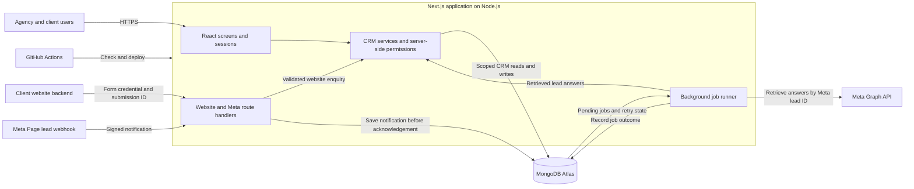

# BlackBuck CRM Project Requirements Document

Version 0.1  |  Draft for review  |  13 November 2026

BlackBuck CRM gives BlackBuck Studios and its clients one place to work leads from Facebook and Instagram Instant Forms and website enquiry forms. Salespeople can see who needs a follow-up. Client owners and agency account managers can see which campaigns generated qualified enquiries and won sales.

### Pilot scope

Launch with BlackBuck Studios and one client. Connect the client’s Meta Page and one Instant Form configured for the Facebook and Instagram placements being tested, plus one website form. Deliver account invitations, role-based access, manual lead entry, automated intake, assignment, follow-up, pipeline history, and campaign reporting.

### Customer service model

Pilot the CRM as part of BlackBuck Studios’ campaign management service. BlackBuck configures and tests lead sources, trains the client team, monitors integration failures, and reviews campaign outcomes. The client sales team owns follow-up and closing by default.

During the pilot, review missed follow-ups and lead quality weekly. Use the monthly campaign review to discuss enquiry volume, first-contact time, qualification, and won outcomes. Agree on business hours, escalation contacts, and response targets during onboarding.

### Future scope

Standalone subscriptions, billing, self-service onboarding, managed lead qualification, and messaging inboxes for Facebook Messenger, Instagram DMs, and WhatsApp are future release candidates.

## Users and Access

**R01  Agency administrator** Create client accounts, invite agency staff and client managers, configure form connections and assignments, and see reporting across the agency.

**R02  Agency account manager** View campaign results and enquiries for assigned clients and reassign leads within those accounts. Sales follow-up access requires an explicit grant when BlackBuck provides that service.

**R03  Client sales manager** Invite salespeople and view, assign, and reassign enquiries within their client account. Review team follow-ups, campaign outcomes, and unassigned enquiries.

**R04  Salesperson** View assigned enquiries, log calls and messages, schedule the next action, and update the pipeline.

**R05  Platform operations** Provision agency workspaces and monitor service health. Any exceptional access to customer records requires authorization and an audit trail.

### Account boundaries

The agency is the SaaS tenant. Each client has its own people, forms, contacts, enquiries, and reports. A user’s membership defines their role and scope. Apply access rules on the server for lists, individual records, reports, reassignments, and any exports. Reject assignments to users outside the enquiry’s client account.

## Lead Intake and Routing

**R06  Meta Instant Forms** Verify the Page webhook and store the lead notification durably before acknowledging it. Retrieve form answers using the Meta lead ID. Map the connected Page and form to the client. Save the form, campaign, ad, and Facebook or Instagram placement when available. Display Meta with unknown placement when placement is missing.

**R07  Website forms** Register each form to a client. The website backend submits through a form-scoped credential and sends a stable submission ID, customer details, enquiry answers, and available landing page and campaign parameters. Preserve tracking through the website journey when the site can capture it.

**R08  Manual entry** Allow authorized users to create an enquiry within their permitted client scope. Identify manual entry as the intake channel and retain any campaign information supplied.

**R09  Contacts and duplicate delivery** Match contacts within the client account using normalized contact details. Keep separate legitimate enquiries for returning contacts. A repeated external submission must resolve to the same enquiry using its source and external submission identity.

**R10  Assignment and recovery** Assign new enquiries to the active default salesperson for the form. Send enquiries without an eligible assignee to the client’s Unassigned queue. Hold unmapped submissions for agency admin review. Retry temporary retrieval failures and surface persistent failures and the last successful import.

### Attribution example

A prospect clicks a tagged Instagram ad and completes the website form. Store Website as the intake channel and Instagram as the marketing source when supported by tracking. Keep the original attribution through later sales activity and show missing campaigns as Unattributed.

## Sales Workflow and Reporting

**R11  Daily sales queue** Show New, Due today, and Overdue enquiries. A salesperson can open the enquiry, view contact and source details, record a call or message outcome, and schedule the next action. Client managers can also review unassigned enquiries.

**R12  Pipeline and activity history** Support New, Contacted, Qualified, Proposal Sent, Won, and Lost. Record the actor and timestamp for stage and assignment changes. Retain follow-up history and capture the outcome of contact attempts.

**R13  Campaign reporting** Filter by client, date, source, and campaign. Group enquiries by original attribution and submission date. Count enquiries received, enquiries that reached Qualified, and enquiries marked Won. Count each enquiry once per metric and retain qualification history when a lead moves to a later stage.

**R14  Response monitoring** Record first-contact time from the first logged contact attempt. Give client managers visibility into unassigned enquiries and those awaiting first contact. Agree the pilot business-hours rule and first-contact target during onboarding.

### Pilot measures

Review intake coverage, unassigned and overdue enquiries, time to first contact, qualification rate, and won enquiries. Use the underlying enquiry list to reconcile campaign totals. Use Won enquiries as the metric label until the team agrees how to link multiple enquiries to a single sale.

## Technology and Release Criteria

### Agreed stack

Use one Next.js application with React and TypeScript on Node.js, MongoDB Atlas for persistence, and GitHub Actions for pull request checks and deployments. The Next.js server handles authentication and authorization. Use durable processing for intake retries. Keep staging and production databases, credentials, and integrations separate.

### Pilot architecture

Website and Meta intake share contact matching, duplicate detection, and form-based assignment. MongoDB stores CRM records and durable Meta job state. The job runner uses the same codebase. Hosting determines how it runs and retries independently of the webhook request. GitHub Actions deploys to staging and production, each with separate database access, credentials, and source connections.

### Operational requirements

Protect form credentials and Meta tokens. Use HTTPS and limit sensitive customer details in operational logs. Monitor failed intake and delayed processing. Verify database backup restoration before onboarding live customer data.

### Pilot acceptance

**A01** Test Facebook and Instagram Instant Form submissions and a tagged website submission. Each appears for the correct client and assignee with the attribution available from its source.

**A02** Replay a submission and confirm there is one enquiry. Verify recovery from a temporary retrieval failure, visible handling of an unmapped form, and routing when an assignee is unavailable.

**A03** Log a call, schedule a follow-up, qualify the enquiry, and mark it Won. Verify the original campaign totals against the underlying enquiry.

**A04** Verify permissions across two agencies and two clients within one agency. Confirm that out-of-scope reads, updates, reports, and assignments are denied.

### Decisions for review

Confirm the pilot client and follow-up owner, business hours and response target, hosting provider and region, authentication provider, data retention and export terms, and pilot success targets. After PRD approval, derive the implementation and status tracker from the numbered requirements.
